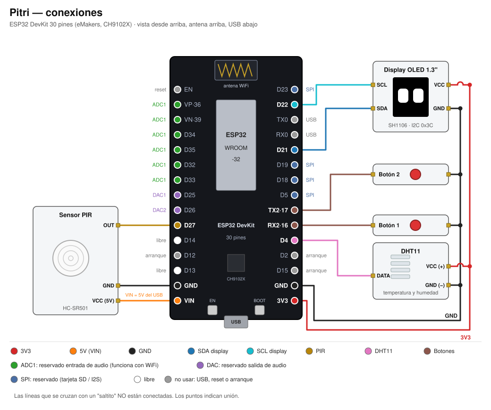

# Pitri — Conexiones

Placa: **ESP32 DevKit de 30 pines** de eMakers (estilo DOIT DevKit V1), con módulo ESP32-WROOM-32,
chip USB CH9102X y 4 MB de flash.

En la placa los pines están impresos como `D21`, `D22`, etc. (`D21` = GPIO 21). Los únicos con otro
nombre son `TX2` (GPIO 17), `RX2` (GPIO 16), `VP` (GPIO 36) y `VN` (GPIO 39).



En el código, los pines están en
[`components/board_config/include/board_config.h`](../components/board_config/include/board_config.h).
Si se cambia un cable, hay que cambiarlo ahí y en este documento.

## Tabla de conexiones

| Periférico | Pata del periférico | Pin de la placa (serigrafía) | Notas |
|---|---|---|---|
| **Display OLED 1.3" (SH1106)** | VCC | 3V3 | |
| | GND | GND | |
| | SCL | D22 | I2C, dirección 0x3C |
| | SDA | D21 | |
| **Sensor PIR HC-SR501** | VCC | **VIN** (5 V del USB) | Con 3,3 V no funciona |
| | GND | GND | |
| | OUT | D27 | Da 3,3 V cuando detecta: va directo |
| **DHT22 / AM2302** | VCC (+) | 3V3 | |
| | DATA | D4 | Necesita pull-up de 10 kΩ a 3V3 (ver abajo) |
| | GND (−) | GND | |
| **Botón 1** | una pata | RX2 (GPIO 16) | La otra pata a GND |
| **Botón 2** | una pata | TX2 (GPIO 17) | La otra pata a GND |

Todos los GND van juntos (la placa tiene dos pines GND, uno de cada lado). El 3V3 alimenta al
display y al DHT22; el VIN (5 V) solo al PIR.

## Por qué estos pines

El ESP32 tiene muchos pines, pero no todos sirven para todo. Los criterios fueron:

1. **Dejar libre lo que vamos a necesitar para audio y WiFi.**
   - El ESP32 tiene dos conversores analógicos: **ADC1** (D32–D35, VP y VN) y **ADC2**. El ADC2 **no funciona cuando el WiFi está prendido**, así que la entrada de audio tiene que ir por el ADC1. Por eso no conectamos nada en esos pines.
   - Las salidas analógicas (**DAC**) existen solamente en **D25 y D26**. Quedan reservadas para la salida de audio.
2. **Usar pines digitales "tranquilos".** D4, RX2 (16), TX2 (17), D21, D22 y D27 no tienen ninguna función especial al arrancar la placa. Se pueden usar como entrada o salida sin sorpresas.
3. **Usar los pines I2C estándar.** D21 (SDA) y D22 (SCL) son los que usa casi todo el mundo con el ESP32, así los ejemplos de internet coinciden con Pitri.
4. **Dejar libre el bus SPI** (D18, D19, D23 y D5) por si más adelante agregamos una tarjeta SD para guardar sonidos, o un módulo de audio I2S.

> **Cambio respecto al proyecto dht22:** el display pasó de D19/D18 a D21/D22 y el DHT22 de D23 a D4, para dejar libre el SPI. Los LEDs RGB se sacaron porque por ahora no se usan.

## Pines reservados y prohibidos

| Pines | Estado | Para qué |
|---|---|---|
| D25, D26 | Reservado | DAC → salida de audio |
| D32, D33, D34, D35, VP, VN | Reservado | ADC1 → entrada de audio (D34, D35, VP y VN son solo entrada, ideales para analógico) |
| D5, D18, D19, D23 | Reservado | SPI → tarjeta SD o audio I2S |
| D13, D14 | **Libre** | Para lo próximo que agreguemos (D14 hace pulsos al arrancar: mejor como entrada) |
| D2, D12, D15 | No usar | Deciden cómo arranca la placa. Si tienen algo conectado, a veces la placa no arranca o no se deja programar |
| TX0, RX0 | No usar | Comunicación por USB con la compu (programar y monitor serie) |
| EN | No usar | Es el reset |

## Consejos para el armado

- **PIR lejos de la antena.** El HC-SR501 es sensible a las ondas del WiFi y puede dar falsas detecciones si está pegado a la antena del ESP32 (la parte de arriba de la placa, con el zigzag dorado). Conviene separarlo unos centímetros, con los cables hacia el lado del USB.
- **Pull-up del DHT22.** Si el DHT22 viene en una plaquita con 3 patas, la resistencia de 10 kΩ ya viene incluida. Si es el sensor solo, con 4 patas, hay que poner una resistencia de 10 kΩ entre DATA y 3V3. La tercera pata del sensor suelto no se conecta.
- **Botones sin resistencia.** Cada botón va entre su pin y GND. El ESP32 tiene una resistencia interna (pull-up) que se activa desde el código.
- **Cables del display cortos.** El I2C funciona mejor con cables de menos de 20–30 cm.
- **Una sola alimentación.** La placa se alimenta por el USB. No conectar otra fuente al pin VIN al mismo tiempo.

## Ideas para el audio (más adelante)

- **Simple:** un parlante chiquito con un amplificador (por ejemplo, PAM8403) en el DAC (D25), y un micrófono con amplificador (por ejemplo, MAX9814) en el ADC1 (VP). El DAC del ESP32 es de 8 bits: alcanza para pitidos y voces "de robot", ideal para Pitri.
- **Mejor calidad:** audio digital I2S, con un amplificador MAX98357A y un micrófono INMP441. El I2S se puede mapear a casi cualquier pin; usaríamos los reservados.

## Regenerar el dibujo

El diagrama se genera con un script de Python:

```
python docs/img/gen_conexiones.py docs/img/conexiones.svg
```

Si se cambia un pin, hay que actualizar el script además de `board_config.h`.
